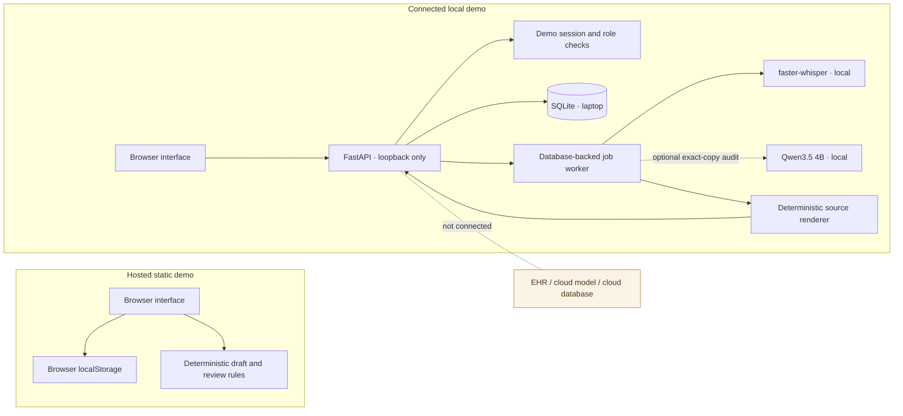

# ClinicNote Studio

**Source-grounded visit documentation prototype with clinician-controlled review.** ClinicNote captures one encounter, creates a traceable draft, and requires approval of the exact version before local export.

> **Status:** Development prototype using fictional data. Not validated or intended for clinical use. The hosted demo is static and browser-local; speech recognition, API, database, and optional language-model paths run only in the separate local setup.

| | |
| --- | --- |
| Hosted demo | [yash3561.github.io/clinicnote-studio](https://yash3561.github.io/clinicnote-studio/) |
| Visual architecture | [System map](https://yash3561.github.io/clinicnote-studio/architecture.html) |
| Local backend | FastAPI at `127.0.0.1:8784` |
| Data | Synthetic fixtures only |
| Integration | No live EHR or clinic connection |

## Scope

The prototype demonstrates a single-encounter workflow: transcript entry or local audio transcription, speaker confirmation, source-linked note drafting, uncertainty flags, reviewer edits, version-bound approval, and local text/JSON export.

It does not provide a canonical patient registry, verified longitudinal identity, clinical inference, production authentication, patient-data ingestion, EHR write-back, outbound notifications, or clinical validation. The hosted site does not connect to the laptop backend or local models.

## Current architecture

The two demonstration modes are intentionally separate.



### Encounter processing

```mermaid
sequenceDiagram
  actor Reviewer
  participant UI as Browser
  participant API as Local API
  participant DB as SQLite
  participant STT as Speech service
  participant Draft as Source renderer
  Reviewer->>UI: Add audio or transcript
  UI->>API: Submit to current encounter
  API->>DB: Persist job and source version
  API->>STT: Transcribe locally
  STT-->>API: Timestamped segments; speakers Unknown
  API->>DB: Store transcript version
  API->>Draft: Build source-linked draft
  opt Optional exact-copy audit
    Draft->>Draft: Validate candidate quotes against source spans
  end
  Draft-->>API: Note sections and unresolved flags
  API->>DB: Persist draft and job events
  API-->>UI: Return draft for review
  Reviewer->>UI: Correct, review, and approve exact version
  UI->>API: Request version-bound approval/export
  API->>DB: Recheck access and versions
  API-->>UI: Approval state or stale-version error
```

Speech recognition does not establish speaker identity. A source-linked draft can still reflect a transcription error; reviewers must confirm the source and attribution. Export currently copies or downloads locally and does not write to an external chart.

For the visual user flow and proposed system map, see the [architecture page](https://yash3561.github.io/clinicnote-studio/architecture.html). The detailed target database relationship model is also documented in [Architecture](docs/ARCHITECTURE.md).

## Implementation

| Layer | Current implementation | Boundary |
| --- | --- | --- |
| Frontend | Static HTML, CSS, and JavaScript | Hosted demo stores synthetic state in that browser |
| API | FastAPI | Local loopback only; demo identity, not enterprise SSO |
| Database | SQLite | Local development persistence; no canonical patient table |
| Processing | Database-backed worker with leases, bounded retries, cancellation, and idempotency keys | Not load-tested as a distributed service |
| Speech | faster-whisper | Local inference; speaker labels require confirmation; no clinical benchmark |
| Language model | Optional Qwen3.5 4B exact-source copy audit | Not a note generator or clinical verifier; no fine-tuning performed |
| Drafting | Deterministic source renderer | Missing or unclear content remains flagged or undocumented |
| Review/export | Source/draft version checks and explicit approval | Local copy/download only; no EHR integration |

The current SQLite tables are `encounters`, `jobs`, `events`, `context_records`, and `source_versions`. The encounter body stores the current draft and immediate previous draft; there is no complete note-version archive. A normalized `clinic → patient → encounter` schema and external workspace adapter are proposed work, not implemented services.

## Data handling and evaluation

- Demo fixtures are fictional. Runtime state, downloaded datasets, model weights, recordings, and the local database are excluded from Git.
- Public datasets researched for future evaluation are not used as clinical training data in this prototype.
- No clinical fine-tuning or clinical accuracy claim is made.
- Evaluation results and sample limits are recorded in [Verification](docs/VERIFICATION_V2.md).
- Training-data eligibility and promotion gates are described in [Training plan](training/README.md).

The product boundary is documentation support. Clinical interpretation, diagnoses, treatment decisions, orders, alerts, and patient communication are out of scope. A future pilot would require approved use cases, representative reviewer-labeled data, explicit acceptance thresholds, privacy/security review, and a tested integration contract.

## Development

Requires Python 3.12, `uv`, and Node.js.

```sh
uv venv --python 3.12 .venv
uv pip install --python .venv/bin/python -r requirements-lock.txt
scripts/serve-local.sh
```

Open `http://127.0.0.1:8784/`. The backend stores its local database under ignored `work/`. To enable the optional local model path, start the isolated runtime in another terminal:

```sh
../local-assistant/runtime.sh serve
```

For the static frontend only, serve `dist/` with any static file server. Local model weights and speech models may require separate downloads.

## Verification

```sh
node --test tests/core.test.mjs
.venv/bin/python -m pytest -q
```

See [Verification](docs/VERIFICATION_V2.md) for exercised paths and limits. The Docker and Compose files are development scaffolding and have not been used to establish production readiness.

## Documentation

- [Architecture](docs/ARCHITECTURE.md) — current runtime, proposed production boundaries, and data relationships.
- [Product and integration plan](docs/PRODUCT_AND_INTEGRATION.md) — scope, workflow, integration requirements, and roadmap.
- [Model and scale plan](docs/MODEL_AND_SCALE_PLAN.md) — model boundaries, measurements, data, and deployment options.
- [Context adapter contract](docs/CONTEXT_ADAPTER_CONTRACT.md) — proposed authorized history retrieval interface.
- [Verification report](docs/VERIFICATION_V2.md) — measured behavior and known limits.
- [Training plan](training/README.md) — dataset and model-adaptation gates.
- [Open Font License](docs/OFL.txt) — bundled Poppins font license.
