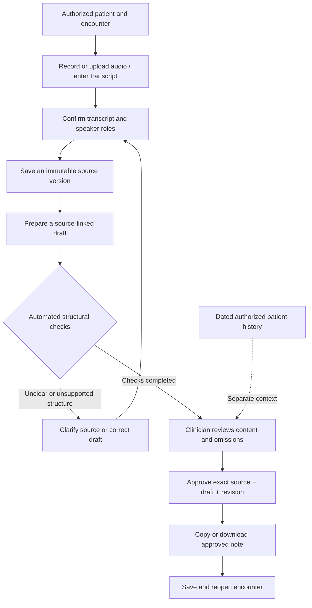
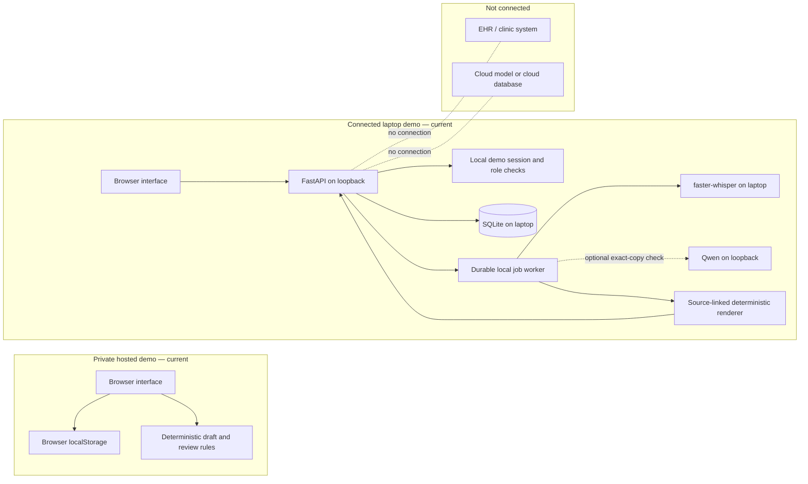
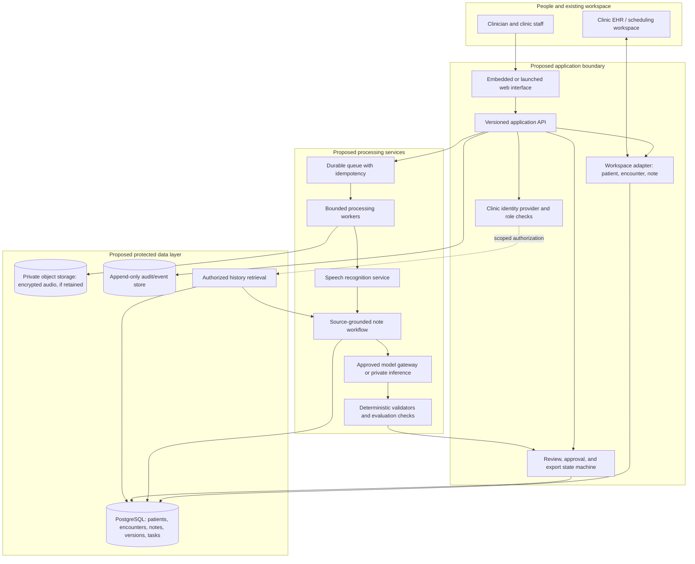
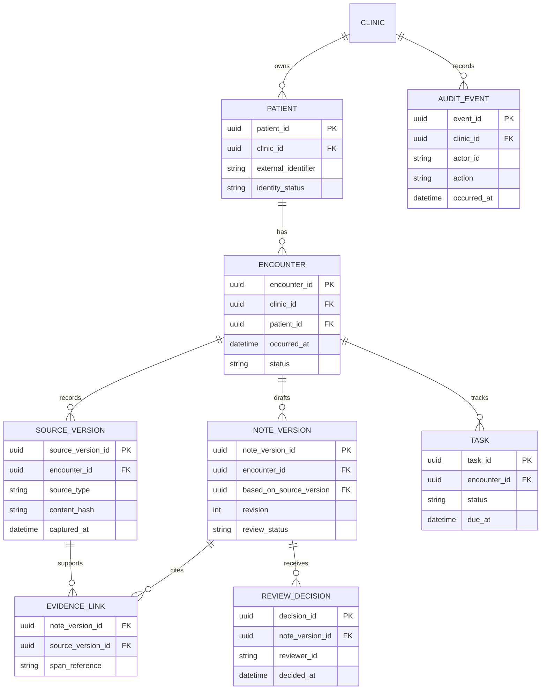
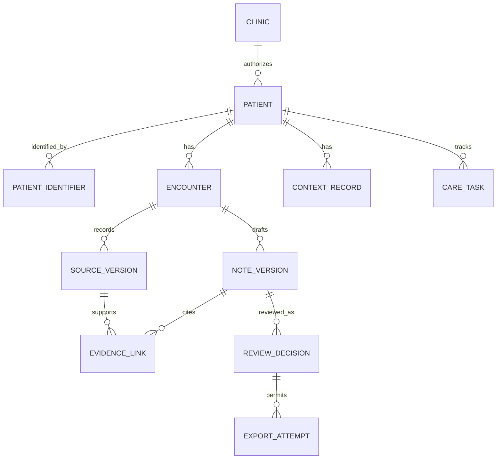

# ClinicNote — what we built, why it works this way, and what comes next

A plain-English product and engineering guide. Updated November 15, 2026.

**The product idea:** help a clinic finish an encounter with a clear, traceable note that a clinician can review and approve. Over time, let the clinician see that visit alongside an authorized, dated patient history. The system organizes evidence and work; the clinician remains responsible for medical interpretation and decisions.

**Current stage:** working development prototype using fictional information, with a separate private hosted demonstration. It has real local backend/model integrations and tested workflow rules. It has not been validated for real clinical use or production deployment.

## Contents

1. [The product in one minute](#1-the-product-in-one-minute)
2. [What works today](#2-what-works-today)
3. [Patient creation and saved history: the precise status](#3-patient-creation-and-saved-history-the-precise-status)
4. [Follow one visit through the system](#4-follow-one-visit-through-the-system)
5. [How the prototype is wired today](#5-how-the-prototype-is-wired-today)
6. [What a production system could become](#6-what-a-production-system-could-become)
7. [The review checklist and readiness packet](#7-the-review-checklist-and-readiness-packet)
8. [Useful insights without acting as a doctor](#8-useful-insights-without-acting-as-a-doctor)
9. [Database and architecture choices](#9-database-and-architecture-choices)
10. [Models, guardrails and public data](#10-models-guardrails-and-public-data)
11. [Our potential differentiator](#11-our-potential-differentiator)
12. [Production plan and acceptance gates](#12-production-plan-and-acceptance-gates)
13. [Alerts and notifications](#13-alerts-and-notifications)
14. [Data-science and interview questions](#14-data-science-and-interview-questions)
15. [Plain-English glossary](#15-plain-english-glossary)
16. [Run, demonstrate and inspect the implementation](#16-run-demonstrate-and-inspect-the-implementation)

## 1. The product in one minute

Imagine a physician finishing a preventive-care follow-up. They need a useful note, want to verify an unclear statement, and may need to look at an earlier record. Today that can involve retyping, switching screens, checking who said something, and remembering which draft is final.

ClinicNote brings the visit, its source, the draft, and the review action into one workspace. The physician can inspect the original wording beside the draft, correct it, and approve that particular version. If the source changes, the earlier approval no longer applies to the changed version.

The system should help answer:

- What was actually said in this encounter?
- Who said it, and how certain was it?
- What information is missing or needs clarification?
- Where did each drafted statement come from?
- Which version did the clinician approve?
- What historical information is available separately, and how old or verified is it?
- What administrative work still needs attention?

It should not infer a diagnosis from symptoms, invent a treatment plan, or silently treat old records as new findings. If a clinician explicitly states an assessment, we preserve that statement with attribution and uncertainty. Removing every diagnosis term would also remove legitimate documentation.

The first audience is a preventive-primary-care workflow suggested by Dr. Sakina Dinani's publicly described role at Navierre. Her exact templates, software, recording process and preferences have not been confirmed. The product remains an independent concept, not a Navierre implementation or endorsement. Public context: [Navierre team](https://www.navierre.com/about), [Eterna](https://www.navierre.com/eterna).

## 2. What works today

There are two distinct ways to use the prototype. They share the interface, but they do not share a database.

| Area | Private hosted demonstration | Connected local version on the laptop |
| --- | --- | --- |
| Encounter worklist | Fictional examples and new fictional encounters | Records saved through the local API |
| Storage | This browser's localStorage | SQLite database on the laptop |
| Draft generation | Deterministic source renderer | Same principle, executed by a durable background job |
| Speech | Local capture/upload/playback; no speech server connection | Local faster-whisper transcription is connected |
| Optional language model | No laptop/model connection | Qwen3.5 4B exact-source copying check |
| Background records | Dated fictional sample timeline | Tenant/patient-scoped stored sample records through the API |
| Care tasks | Device-local administrative tasks | Persistent administrative tasks through the API |
| Review/export | Browser-enforced demo workflow | Server re-checks permissions and exact versions |
| Identity | Sites controls access to the private demonstration | Development session and role checks; enterprise login not implemented |
| Clinical/EHR integration | Not connected | Not connected |

**Working features:** encounter search, fictional encounter creation, transcript editing, local audio capture/upload, source-linked draft statements, SOAP/visit layouts, unclear/unknown-source flags, reviewer edits, version-bound approval, copy/download, prior-draft view, tasks, history view and processing traces. Background/model screens state which mode is connected.

**Not completed:** a canonical patient registry, returning-patient visit creation, automatic history imports, full prior-note archive, verified patient matching, production identity, consent/revocation integration, clinical inference, real alerts/notifications, EHR write-back, or production load/security/clinical validation.

The interface follows the observed navy/white/coral and Poppins cues of Navierre's public site while keeping an independent identity. Poppins files and the OFL license are bundled locally; no Navierre logo or official-product claim is used.

## 3. Patient creation and saved history: the precise status

### What “New encounter” currently does

It creates **a visit record containing fictional patient details**. A name, visit reason and visit type are entered, and the browser assigns identifiers. In connected local mode, the encounter becomes durable when it is saved through the API. It can later be reopened from the worklist.

There is **no separate canonical patients table or complete patient-registration workflow yet**. The current UI also does not let a user select an existing patient and reliably add a second linked visit. Creating the same name twice does not establish that the records describe the same person.

This is a real product gap, not a detail to hide in the pitch. It is the first feature to complete before describing this as a longitudinal patient platform.

### What can be checked later today

The local database retains encounter data, the current draft, an immediately previous draft snapshot, approval state, immutable transcript versions, background sample records, administrative tasks and audit events. The worklist can reopen saved encounters.

Important limits:

- The hosted demonstration's browser data is not synchronized with the laptop or another phone/browser.
- Audio in the interface is temporary unless explicitly processed locally; a production recording archive is not built.
- All previous draft versions are not kept in a dedicated complete note-version table; there is a current and immediately previous draft in the encounter body.
- Background sample records are present, but a general records-upload/import-and-reconciliation workflow is not implemented.
- A counter or matching display name is not enough for safe patient identity.

### The next patient workflow

**Find existing patient → verify identity and access → open patient chart → start a new encounter linked to that patient → document/review → save approved note → reopen it in that patient's visit timeline.**

If the person is new, create a patient record with a stable internal ID and the clinic's external identifiers. Use approved identity fields and matching rules; require manual resolution when a possible duplicate is ambiguous. Do not merge patients just because names or symptoms are similar.

We should test: two patients with the same name; the same patient with a changed name; two clinics using the same external identifier; duplicate import; a visit opened under the wrong patient; and access removed between reading and export.

## 4. Follow one visit through the system



The first box describes the intended patient-linked workflow. The current implementation has encounter/session access checks and embedded patient details; the full patient registry and clinical identity matching still need to be built.

### Step 1: capture the encounter

The user can record or upload fictional audio, or enter a transcript. In local mode, the speech adapter can transcribe the recording on the laptop. It returns timestamps, but labels speakers Unknown. A speech model does not automatically know who is the patient or physician.

The user must correct important recognition errors and confirm speaker labels before the draft is relied on. Missing words, medication names, numbers, negations and overlapping speakers deserve special attention.

### Step 2: save the source

A saved transcript receives a source version: for example, version 1. Editing and saving creates version 2 rather than rewriting the saved version 1. That makes it possible to identify which source a draft used.

The local API stores source snapshots separately. “Immutable” means the application rejects updates/deletes to those snapshots; it does not mean a database administrator could never tamper with the database.

### Step 3: prepare the draft

A background job reads the source and creates the note. The current renderer preserves source wording. Explicit Patient statements remain attributed patient reports. Explicit Clinician Assessment/Plan statements can populate those sections. Unknown or marked-unclear passages are excluded and require clarification. Empty sections remain visibly undocumented.

The optional Qwen path checks exact copying. It is not an independent medical reviewer and does not generate new medical prose in this implementation.

### Step 4: inspect evidence and correct

Source buttons open the original wording next to the note. Reviewer edits are marked as manual. A retained source link supplies context; it does not certify that new reviewer-written text was present in that source.

A citation proves where text is located. It does not prove that the transcript matches the audio, the speaker was identified correctly, or the statement is medically true.

### Step 5: approve this version

The clinician explicitly approves the current source version, draft and revision. Editing the note clears approval. Changing the source or format makes the existing draft stale and requires refresh/review.

In connected mode, the backend enforces that decision again before export. Hiding a button in the browser would not be sufficient protection.

### Step 6: hand off

The current product copies or downloads the approved text/structured demo JSON. It does not send a note to an EHR, order a test, schedule an appointment or contact a patient. A real adapter must confirm the external system's actual write result and handle uncertain/duplicate outcomes.

## 5. How the prototype is wired today

Two modes share the interface. The private hosted demo is a static site and keeps fictional sample records in that browser. The connected developer mode adds the local API, SQLite, local speech recognition and an optional local model. There is no cloud API or clinic system behind the hosted demo.



This diagram is intentionally explicit about the two demo modes. `FastAPI` is the local service boundary; `SQLite` stores the connected prototype's records; the language model is an optional local checking step, not the note writer or a clinical decision maker.

### One audio-to-note request, end to end

```mermaid
sequenceDiagram
  actor Clinician as Demo reviewer
  participant UI as Browser interface
  participant API as Local API
  participant DB as SQLite
  participant STT as Local speech model
  participant Draft as Source renderer
  participant LLM as Optional local exact-copy check

  Clinician->>UI: Select fictional encounter and add audio
  UI->>API: Upload audio under current encounter session
  API->>DB: Save job and source/encounter version
  API-->>UI: Job ID and processing state
  API->>STT: Transcribe local audio
  STT-->>API: Timestamped segments; speakers Unknown
  API->>DB: Save transcript as a new source version
  API->>Draft: Build draft from explicit source text
  opt Optional audit enabled
    Draft->>LLM: Ask for exact quotes mapped to source spans
    LLM-->>Draft: Candidate exact-copy mapping
    Draft->>Draft: Reject altered, missing, extra, or invalid spans
  end
  Draft-->>API: Deterministic note sections and unresolved flags
  API->>DB: Save draft/job events
  UI-->>Clinician: Show source, draft, flags, and review checklist
  Clinician->>UI: Correct transcript/speakers and review note
  UI->>API: Save edits; request approval for exact versions
  API->>DB: Recheck access, source version, draft revision, and state
  API-->>UI: Approve or reject stale/invalid state
  Clinician->>UI: Copy/download approved note
```

The external destination step ends at a local copy/download. No EHR write-back occurs. The transcript may be wrong even if the generated note faithfully copies it, so audio and speaker verification remain human tasks.

## 6. What a production system could become

This is a proposed deployment boundary, not the current prototype. It shows how the interface, clinic workspace, processing, records and model could be separated while keeping the clinician in control.



**Reading the planned map:** the EHR or clinic workspace launches the product with a verified patient/encounter context; an API checks identity and access; a queue hands longer processing to workers; source-grounded processing creates a reviewable draft; the reviewer approves a specific version; and only then does a tested adapter return it to the clinic workspace. A separate, authorized history service can retrieve dated prior records. The proposed arrows do not mean these integrations exist today.

### Proposed database relationship map



This is a target model. Today the prototype has no canonical `patients` table and no dedicated complete `note_versions` table. Current SQLite tables and the specific production migration are described below.

For interview preparation, including a nontechnical explanation, design tradeoffs, likely CTO/CFO questions, and a concise project walkthrough, see [Architecture and call guide](docs/ARCHITECTURE_AND_CALL_GUIDE.md).

## 7. The review checklist and readiness packet

Think of this as **a preparation packet for the clinician**, not a certificate that the patient is medically cleared or the note is correct.

### Current checklist behavior

The interface shows source-reference and unresolved-source checks. The local server also checks permissions, versions, required state and approval. The reviewer then confirms review of attribution, uncertainty, omissions and draft text.

The final confirmation is currently one review acknowledgment. We have not implemented a complete individually enforced clinical checklist or an automatic check of every medically important omission. Missing note sections can be allowed through after review; the system cannot know that every required clinical fact has been documented.

### The stronger review packet to build

| Item presented to the reviewer | What it helps establish | Current status |
| --- | --- | --- |
| Verified patient and current encounter | Correct person and visit | Full patient matching still to build |
| Audio/transcript quality and unresolved speakers | Source may need clarification | Local STT + basic unknown/unclear handling; quality validation limited |
| Draft with exact source references | Where drafted content came from | Implemented for current source |
| Missing required sections/facts | What still needs completion | Missing sections shown; clinically important omission detection not implemented |
| Conflicts and later corrections | Whether the draft misstates the source | No general semantic conflict/correction detector yet |
| Separate background records with dates/status | Historical context is not a new finding | Synthetic timeline implemented; live ingestion not connected |
| Manual edits visibly identified | What the reviewer changed | Implemented |
| Current version and review decision | What was actually approved | Implemented, server-enforced locally |
| Export destination and result | Where the approved note went | Local download/copy only |

A simple traffic-light presentation could help later, provided its labels are precise: “source clarification needed,” “ready for clinician review,” “reviewed version approved.” Avoid a generic “medically safe” green score.

## 8. Useful insights without acting as a doctor

There are three different categories, and they need different levels of validation.

### A. Evidence organization

Examples: “This historical record was entered on October 2,” “This history item is unverified,” or “Today’s clinician assessment says the cause is not established.” Each statement should identify its source and date.

We already display a separate synthetic background timeline and source references. We do not yet compute a general patient-level longitudinal summary or reconcile imported records automatically.

### B. Workflow insights

Examples to build: notes waiting for review, failed jobs, time from upload to reviewed note, tasks still pending, and how often users correct a field. These help a clinic operate its documentation process without interpreting a patient's health.

We store jobs, tasks and audit events locally, but a validated aggregate analytics dashboard is not built. Event definitions, missing data and denominators must be checked before reporting savings or productivity.

### C. Clinical interpretations or risk signals

Examples: a new diagnosis, a suggested treatment, or a prediction that someone is at risk. These require a separately defined use case, suitable evidence, validated performance, qualified review and the organization's product/regulatory assessment. They are not current ClinicNote features.

A factual change such as two differently dated values can potentially be shown with both sources. Calling that change dangerous, diagnosing its cause, or recommending treatment is an additional clinical interpretation. Do not let a general-purpose model silently cross that boundary.

For a future healthcare assistant, provide purpose-scoped access to the authorized record and source-linked responses. Reading context must not automatically grant the ability to change a chart, prescribe or message a patient. See [the context adapter contract](docs/CONTEXT_ADAPTER_CONTRACT.md).

## 9. Database and architecture choices

### What database are we using now?

**SQLite in the connected local version.** It is an actual SQL database stored in a file on the laptop. It lets us implement transactions, constraints and persistence with minimal setup and operating cost.

The hosted preview uses **browser localStorage**, which is different. It is suitable here for fictional demonstration state. It is not the shared clinical database we would deploy for a clinic.

### Why SQLite for development?

It supports the behaviors we need to examine: a visit and its source version can be saved together, repeated operations can be identified, and concurrent revisions can be checked. It makes the first complete workflow easy to run and inspect.

SQLite's WAL mode allows useful read/write concurrency, but writes are still coordinated through the local database file. This is not our claim of a horizontally scalable multi-clinic deployment. We should measure the workload and move production transactional storage into the host's approved infrastructure.

### What is stored now?

| Table | Plain-English purpose |
| --- | --- |
| `encounters` | Visit data, current draft, immediately previous draft, approval state and tasks in a JSON body; indexed by clinic/tenant and encounter ID, with a revision counter |
| `source_versions` | Saved transcript snapshots for each visit/version |
| `jobs` | Durable processing requests, status, attempts, lease and operation identity |
| `context_records` | Separately stored background records keyed by clinic/tenant and patient reference |
| `events` | Append-only application action metadata |

Patient details currently live inside encounter data. There is no canonical patients table yet. Keeping many changing objects inside one encounter JSON body is convenient now but becomes a poor fit for querying, enforcing relationships and retaining a complete history at scale.

### What database should production use?

**Managed PostgreSQL is our proposed default**, unless Navierre's existing database and operational standards provide a better fit. It supports relational constraints, transactions, indexing and flexible JSON fields while preserving a clear relationship between a patient, visits, source documents and reviews. The team already owning a reliable platform is a major consideration; we should not create a parallel stack merely to match a preferred technology.

A document database can fit some flexible records, but our core workflow contains important relationships and coordinated state changes. SQL fits those requirements naturally. This is a reasoned proposal, not a completed PostgreSQL migration or a claim that one database wins every workload.

### Proposed production schema



This diagram is a proposed schema, not the schema currently deployed. Membership, identity, consent/grants, jobs and audit records also need explicit tables/policies. Relationships alone do not enforce permissions.

Use private object storage for approved audio/documents, and put metadata and references in PostgreSQL. A vector index, if justified by measured search needs, is a search aid; it should not become the authoritative store of consent, note approval or source truth. We have not implemented vector search or a production recording archive.

### Why aren't we deploying lots of microservices now?

The implementation has modules inside one local API and a background processing loop. They have separate responsibilities: encounter/source, jobs, drafting/model adapter, context, review/export, tasks and audit.

Independent deployments add network calls, failure handling and operations. Split STT/model workers or other services when workload, ownership or deployment needs justify it. A practical growth path is one API with clear contracts, a managed database, private media storage, then separately scalable workers with a durable queue.

## 10. Models, guardrails and public data

| Component | Current implementation | Why |
| --- | --- | --- |
| Speech | Local faster-whisper, `small.en`, CPU int8 | A low-cost development path with timestamps; speaker roles still require confirmation |
| Optional language model | Local Qwen3.5 4B through Ollama | Tests a constrained source-copy interface; not required for default note wording |
| Note wording | Deterministic source renderer | Avoids an unnecessary generative call for simple, exact-source drafting |
| Backend | Python/FastAPI | Typed API boundaries, background coordination, integration with Python model tooling |
| Schemas | Pydantic | Rejects invalid structured inputs; not proof of medical truth |
| Storage | SQLite locally | Transactions and persistence with little development overhead |

The language model receives only the selected current transcript spans in this path. It must return the exact source text and IDs. Altered numbers, extra fields, invented wording, unknown IDs or missing spans are rejected. The final note still uses deterministic rendering.

This is how we constrain output; it does not remove pretrained knowledge from a model. Transcript quality, source labeling, omission, organization and human edits can still be wrong. Strict copying is also not the same as useful clinical summarization. We must evaluate whether later structured extraction/paraphrasing improves the user task without introducing consequential errors.

### What did we measure?

- 12 backend and 12 JavaScript core software checks passed.
- Four synthetic exact-copy development cases initially passed 3/4. After reducing duplicate input fields, the same four passed 4/4. That is input/prompt adaptation on reused development cases, not an independent test or clinical accuracy result.
- One 5.4-second synthetic spoken clip exposed a tiny.en error: “cause” became “calls.” small.en preserved that sentence. Two cached-weight small.en runs took about 3.0 and 1.9 seconds. No representative clinical speech benchmark was completed.
- A local model-backed encounter job and a real local transcription HTTP request were exercised through the implementation.

### Can we train with public data?

We downloaded MTS-Dialog's 1,201 training and 100 validation records from a pinned upstream revision, saved its license/citation/hashes, and prepared split-preserving candidates. No fine-tuning occurred, and test data was not downloaded. ACI-BENCH was researched as a fuller-encounter candidate but not imported.

The candidates are explicitly unreviewed and not automatically eligible for training. Reference notes must be checked for source support and alignment with our documentation policy. Public data also may already have appeared in model pretraining, so public benchmark scores alone cannot establish performance on the clinic's unseen cases.

The next training decision should follow a clear task, baseline and reviewed evaluation. We might train an adapter for source extraction or a particular documentation style if it demonstrates a measurable benefit. We should not fine-tune just to say we have a custom medical model.

Details, licenses, measurements and sources: [model and scale plan](docs/MODEL_AND_SCALE_PLAN.md), [training plan](training/README.md), [verification](docs/VERIFICATION_V2.md).

## 11. Our potential differentiator

Our strongest product hypothesis is **reviewable continuity**: the clinician can see where a note came from, what was uncertain, what changed, and what exactly they approved, while accessing historical context without mixing it into today's facts.

That has five practical parts:

1. **Evidence beside the work.** The reviewer can inspect wording without leaving the note.
2. **Visible missingness.** An unspoken finding remains undocumented rather than being filled with plausible prose.
3. **Change-aware review.** A changed source or note cannot inherit an older approval.
4. **Separate historical context.** A dated, unverified record does not silently become a current finding.
5. **A bounded handoff.** The system hands off an approved version and must eventually verify the destination's actual result.

Some parts are implemented; full longitudinal identity/history and verified external handoff remain to build. These are candidate differentiators, not evidence that competitors lack them or that we have a market moat.

The real advantage would be proving that this combination reduces reviewer effort and consequential documentation errors in the target workflow. A polished interface alone is not that proof. We need clinician comparisons against their current process and evidence of usefulness, not an invented accuracy or savings number.

A clinician-facing explanation:

> “You can see what the draft says, where it came from, and what still needs your attention. Your corrections stay visible, and your approval belongs to the exact version you reviewed. Historical information is available separately, so it does not silently become a new finding.”

## 12. Production plan and acceptance gates

The sequence below is a proposal to agree with the team. It is not a promised delivery calendar.

### Gate 1 — agree on the actual task

Inspect authorized failed examples, clinician corrections and existing workflow. Define permitted transformations, required fields, severe errors, target users, accepted note formats and intended downstream actions.

**Evidence needed:** clinicians and product owners agree on representative accepted/rejected examples and how to judge them. A vague instruction to “make it better” is not enough.

### Gate 2 — complete patient identity and longitudinal persistence

Add a canonical patient entity, clinic/external identifiers, verified selection, returning-patient visits, an immutable full note-version archive and authorized history ingestion. Link current/historical evidence explicitly. Provide retrieval of prior reviewed notes without replacing them when a new visit occurs.

**Evidence needed:** duplicate-name and cross-clinic tests, patient/visit linkage tests, revision conflicts, source corrections, re-review, restricted-history access and no unintended cross-patient joins.

### Gate 3 — validate the note pipeline

Evaluate representative speech and note cases with qualified reviewers. Include accents/languages, specialties, noisy audio, overlapping speakers, medication/number errors, negation, family history, tentative statements, later corrections and missing information. Compare the current workflow and simpler baselines.

**Evidence needed:** measured unsupported assertions, consequential omissions, attribution/certainty errors, transcription errors, reviewer effort, accepted completion, failure/fallback, cost and latency. Set targets and stop rules before the final held-out evaluation. No universal “perfect” threshold is asserted here.

### Gate 4 — fit their existing workspace

Use the existing identity and encounter launch if available. Confirm supported APIs, scopes, sandbox and write semantics. A link or iframe is only placement; it does not establish authorization or chart-write integration. Implement and test the agreed adapter.

**Evidence needed:** correct patient/encounter launch, scoped access, expired/revoked permissions, versioned write-back, conflict handling and external-result confirmation. No success message before the destination actually confirms the operation.

### Gate 5 — production infrastructure and operations

Move transactional records to the approved managed database; media to private object storage; and long processing to bounded workers/queue as needed. Introduce production identity/roles, secret management, reviewed migrations, retention/deletion, backup/restore, deployment/rollback and operational monitoring.

**Evidence needed:** restore drills, failure/recovery tests, permission isolation, worker duplication/cancellation, dependency outages, quota limits and a measured load test. Docker/Compose files in this repo are unbuilt development scaffolds, not evidence that this gate passed.

### Gate 6 — limited clinical pilot

Start in an agreed restricted workflow with explicit review and a manual path. Train users on limits and collect corrections with a clear process. Review incidents and compare actual review time and accepted task completion.

**Evidence needed:** qualified clinical/product approval of the intended use, operating process and evaluation. Organization-specific legal/privacy/regulatory assessment remains with the appropriate team; this README is not a certification.

### Gate 7 — expand deliberately

Add specialties, languages, history sources, assistants and alerts one at a time, with relevant evaluation and rollout controls. A result in one clinic does not transfer automatically to all clinicians or tasks.

## 13. Alerts and notifications

Yes—most alerting is later work. The current product has visible flags and administrative task status. It does not send email, SMS, push notifications, medical alerts, orders or patient messages.

A sensible order is:

| Proposed notification | Intended recipient | Reason | Status |
| --- | --- | --- | --- |
| Draft ready for review | Authorized staff | Processing finished | Not implemented |
| Job failed or needs input | Responsible staff | Recover the documentation workflow | UI state exists; outbound notification not implemented |
| Source changed after review | Assigned reviewer | Review the changed version | Stale-state protection exists; notification not implemented |
| Administrative task pending/overdue | Assigned staff | Follow-through | Local task status exists; assignment/due dates and reminders not implemented |
| New authorized background record | Care team | Inspect new source/context | No live import/event notification yet |
| Clinical risk or safety signal | Qualified reviewer under defined protocol | Potential clinical decision support | Separate future use case requiring validation |

Build operational notifications before clinical alerts. Add ownership, permissions, delivery status, duplicate suppression, sensible grouping, escalation rules and user preferences. Otherwise the system can create alert fatigue: so many messages that important ones are ignored.

Do not send a patient a diagnosis or treatment instruction just because an AI flagged something. Clinical communication requires a specifically approved workflow and responsible human action.

## 14. Data-science and interview questions

### 1. What exactly are we optimizing?

A completed, acceptable documentation task: useful facts preserved, consequential additions avoided, manageable review effort, reliable completion and reasonable cost. We are not optimizing only for fluent prose, low token count or a single score.

### 2. What is the baseline?

The clinic's current process and the simplest implementation that performs the task. In our development version, exact-source rendering is a baseline. A complex model must improve a defined outcome enough to justify its errors, latency and maintenance.

### 3. How do we measure hallucinations and omissions?

Review a note against the source using an agreed rubric. Count unsupported statements and required facts that were left out, including severity and sample size. A blank note can contain no hallucinations while being useless, so these measures must be considered together.

### 4. What is precision versus recall here?

For a verifier, precision asks how often its warnings are real problems; recall asks how many real problems it catches. For extraction, analogous measures describe correct extracted facts versus required facts found. Always define the unit and labels; these are not interchangeable with a patient diagnosis classifier.

### 5. Where do ROC-AUC or PR-AUC fit?

They summarize ranking of scored classification outcomes across thresholds. They can be appropriate for a separately defined classifier, with labeled data and an operating threshold. They are not the primary measure of whether an entire generated note faithfully represents a conversation.

### 6. Why not use word overlap such as ROUGE alone?

A note can use many of the same words while reversing a negation or assigning a family member's condition to the patient. Text similarity is a useful secondary signal for some tasks, but source support and consequential meaning need their own review.

### 7. Can an LLM grade another LLM?

It can assist review, but it can share errors or prefer fluent outputs. Compare its judgments with qualified human labels, inspect disagreement and evaluate false accepts/rejects. We have not built a clinically validated LLM judge here.

### 8. Why keep test data separate?

If we repeatedly adjust the model after seeing its test failures, that set becomes development data. Keep patient/session lineage and duplicate sources from leaking between splits. Reserve a fresh final evaluation; do not describe four repeatedly used synthetic cases as independent validation.

### 9. What would fine-tuning add?

It might improve a stable extraction or style task with enough suitable examples. It does not fix an incorrect patient, missing source or bad permission rule. Compare it with prompting and deterministic approaches, and evaluate on untouched cases before promotion.

### 10. What is calibration, and should model confidence control approval?

Calibration asks whether stated probabilities match actual observed frequencies. A model's self-reported confidence is not automatically calibrated. Our approval depends on review and state rules; a high confidence score must not bypass missing evidence or an unresolved source.

### 11. What does drift mean?

The inputs or workflow may change: new specialties, languages, recording devices or note preferences. Monitor relevant error slices, user corrections, fallback, latency and cost. Investigate changes before updating a model; do not automatically train on every edit.

### 12. How do we measure business value?

Compare time to an accepted note, correction effort, unfinished work, failures, support effort and system cost in a controlled pilot. State measured results separately from estimates. A quicker first draft can still be worse if review takes longer.

### 13. How do we pick a clinical-alert threshold?

Only after defining a particular alert, its labels, intended action, error costs, review capacity and clinical oversight. Evaluate false positives, missed cases, prevalence and subgroups. A threshold that makes a demo look active is not a release criterion.

### 14. How do we know the system handles scale?

Use a defined workload and measure response/queue times, success/error rate, resource use and cost. Test dependency failures and recovery, not only happy-path throughput. We have not performed a distributed production load test or established a maximum patient count.

### 15. What does our evidence currently prove?

The tested prototype rules work on the curated cases exercised, and the local model/speech integrations ran on the reported synthetic inputs. It does not prove clinical safety, universal attribution accuracy, a trained adapter, a competitive moat or production readiness.

## 15. Plain-English glossary

| Term | Meaning in this product |
| --- | --- |
| Patient | The person whose record is being managed; needs a stable verified identity |
| Encounter | One visit or interaction, linked to that patient |
| Tenant | A clinic/organization boundary used to keep access and data separate |
| Transcript | Text produced from the recording; it can contain recognition errors |
| Diarization | Estimating who spoke when; it does not prove the speaker's clinical role |
| Provenance | A record of where information came from |
| Source span | A specific identifiable piece of original text |
| Grounding | Connecting an output claim to supporting source evidence |
| Version | A saved state, such as transcript v1 versus a corrected v2 |
| Revision | A counter used to detect changes and conflicting edits |
| Stale | A draft/review no longer matches the current source or required state |
| API | The contract through which the interface and backend exchange requests/results |
| Backend | Code enforcing storage, permissions, jobs and workflow behind the interface |
| Transaction | A coordinated database change that succeeds or fails together |
| Job/worker | A saved processing request / the process that performs it |
| Queue | A buffer of jobs waiting for processing |
| Lease | Temporary worker ownership; expired ownership can allow recovery |
| Idempotency | Repeating the same operation should not duplicate its intended effect |
| Optimistic concurrency | Rejecting a save if someone changed the record since it was read |
| Audit event | Metadata recording an action, actor/context and time |
| Guardrail | A particular rule/check; its name alone does not establish correctness |
| Human review | The clinician inspects and decides; review itself still can miss errors |
| RAG | Retrieving selected external evidence before a model answers |
| Embedding | Numbers used to compare content similarity; not a truth or permission score |
| LoRA/adapter | A smaller set of trainable model changes; not a source of fresh patient facts |
| Fine-tuning | Changing model parameters using examples; not performed clinically here |
| FHIR | A healthcare data exchange standard; JSON alone does not make an export FHIR-compliant |
| EHR | The clinic's electronic health record system |
| p95 latency | A time within which 95% of a defined set of requests finished |
| Clinical validation | Qualified evaluation that a system fits its particular clinical intended use |

## 16. Run, demonstrate and inspect the implementation

### Hosted demonstration

The owner-private preview uses browser-local fictional data. It is separate from this public repository and is not a shared clinic service. Its patient background and tasks do not imply a live clinic connection or shared production database.

### Connected local version

From this project directory:

```sh
# Create a Python 3.12 virtual environment and install the pinned dependencies.
uv venv --python 3.12 .venv
uv pip install --python .venv/bin/python -r requirements-lock.txt

# Start the local API and interface.
scripts/serve-local.sh
```

Open http://127.0.0.1:8784/ on the laptop. A local session is bootstrapped and fictional encounters are seeded. That local cookie/session is not production SSO or an authenticated clinician signature.

For the optional Qwen path, start the existing isolated runtime in another terminal:

```sh
../local-assistant/runtime.sh serve
```

Normal Mac GPU access is required. Model inference stays local at the configured loopback endpoint; no public model listener was added. Local speech may need an initial weight download. Model/dataset/runtime artifacts are in ignored `work/` and excluded from publication.

### Checks

```sh
node --test tests/core.test.mjs
.venv/bin/python -m pytest -q
```

The local database is `work/clinic.sqlite`. Treat future real data and backups as sensitive; this prototype is currently for fictional inputs only. Docker/Compose are development scaffolds and were not built/run as evidence of production readiness.

### Five-minute demonstration

1. Open Avery's visit and show the note alongside an original source statement.
2. Show the clinician's uncertainty and the examination section left undocumented.
3. Edit, explicitly approve, and locally export the note.
4. Show Riley's unclear/unknown source blocking approval.
5. Open separate historical context and a clerical task.
6. Change a source and show why the old review cannot approve the changed version.

Explain that the patient registry, complete note archive, clinical interpretation and external connectors are planned work. Do not portray a mock connector, replayed result or browser sample as a live integration.

### Source map

- `backend/app.py`: local API, session/role boundaries, jobs, review, context, tasks and export.
- `backend/store.py`: SQLite schema, transactions, revision checks and append-only constraints.
- `backend/grounding.py`: source parsing, exact-copy model contract, deterministic drafting and validation.
- `backend/speech.py`: local speech adapter with explicit Unknown speaker output.
- `dist/app.js`, `dist/core.js`: interface and browser-mode workflow rules.
- `dist/context.js`: synthetic background records and module catalog.
- `tests/`: curated software checks.
- `scripts/prepare_dataset.py`: source-hash-checked, split-preserving public data preparation.
- [Model and scale plan](docs/MODEL_AND_SCALE_PLAN.md): detailed configurations, measurements and deployment boundaries.
- [Context contract](docs/CONTEXT_ADAPTER_CONTRACT.md): compatibility with a future longitudinal assistant.
- [Training plan](training/README.md): proposed adaptation and promotion gates.
- [Verification](docs/VERIFICATION_V2.md): what was actually exercised and what was not.

The next most valuable build is the canonical patient/returning-visit/history workflow, followed by a clinician-agreed evaluation and the actual workspace adapter. Broader alerts, risk interpretation and more independently deployed services come after those foundations demonstrate value.


### Primary technical references

[SQLite WAL and concurrency](https://sqlite.org/wal.html), [PostgreSQL relational constraints](https://www.postgresql.org/docs/current/ddl-constraints.html), and [PostgreSQL JSON support](https://www.postgresql.org/docs/current/datatype-json.html) support the database discussion. The database migration and production design remain proposals; those documents do not establish this prototype’s deployment readiness.
