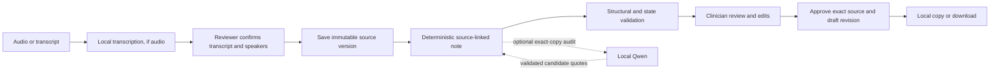
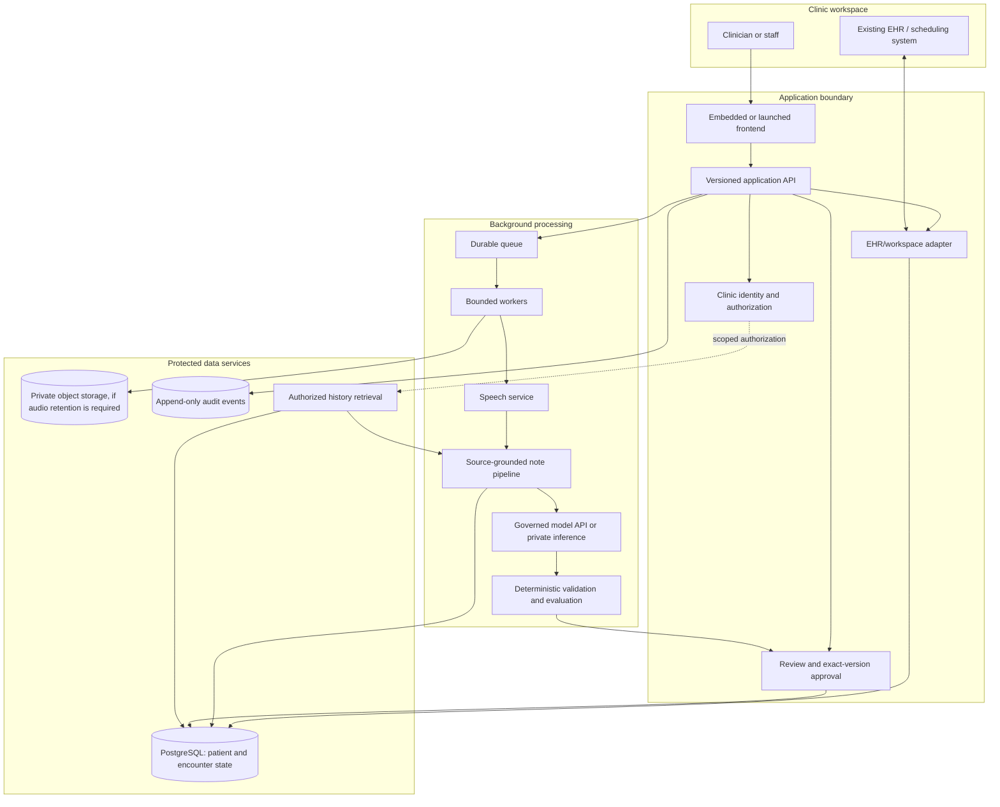
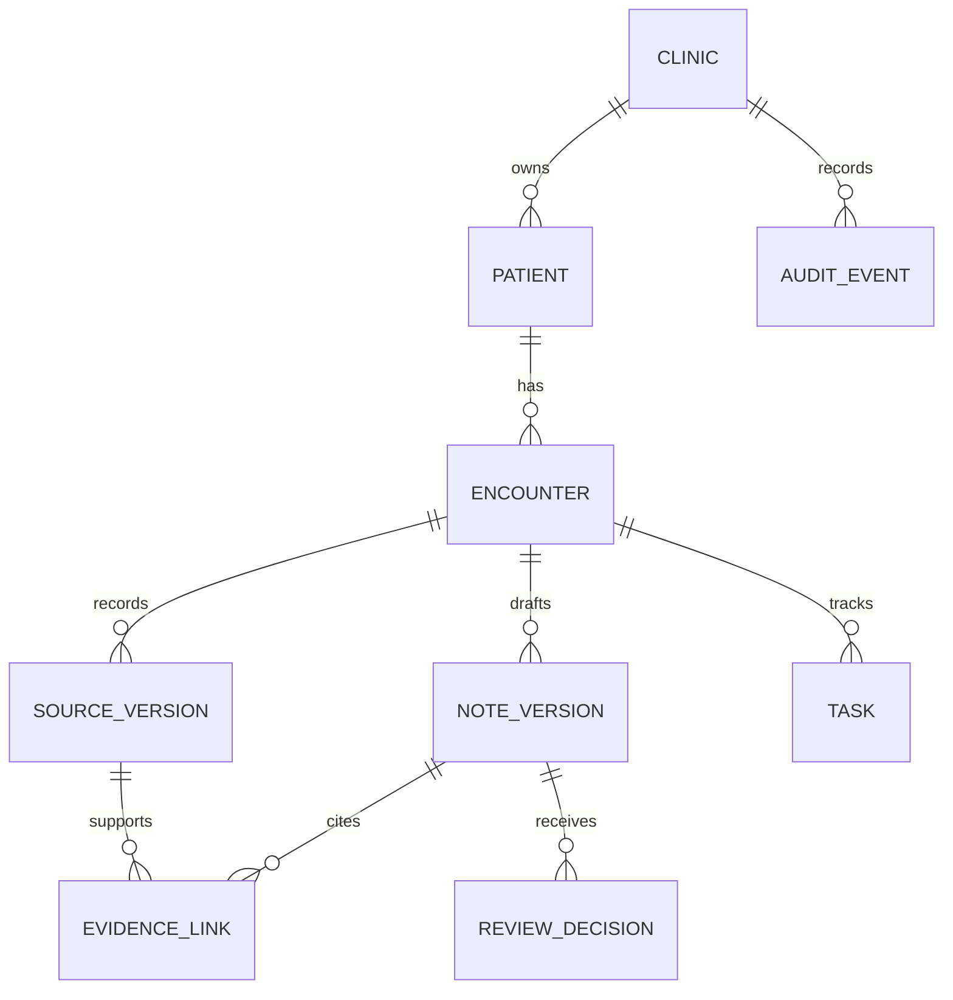

# Architecture

This document records the current implementation and a proposed production boundary. Proposed components are labeled; they are not deployed or selected integrations.

## Current runtime

### Hosted static demo

The GitHub Pages deployment serves files from `dist/`. The interface runs in the browser and stores fictional demo state in browser storage. It does not call the laptop API, database, speech service, local model, cloud model, or an EHR.

### Connected local demo

The browser calls FastAPI on `127.0.0.1:8784`. The API creates a local demo session, validates requests, applies tenant/role and version checks, persists records in SQLite, and enqueues processing jobs. A database-backed worker claims jobs with a lease and invokes faster-whisper for local transcription. The deterministic renderer creates the note from explicit source statements. An optional Qwen step checks exact source copying; server-side code validates its output. Speakers remain Unknown until confirmed by a reviewer.

Review and export require the current source version, current draft revision, and valid reviewer state. Export produces a local copy or download. No external chart write occurs.

### Current persistence

The SQLite schema contains `encounters`, `jobs`, `events`, `context_records`, and `source_versions`. The encounter body stores the current draft and immediate previous draft. Transcript source versions and audit-style events are separate. There is no canonical patient registry, complete note-version archive, or live history import.

## Encounter data flow

## Proposed production boundary

The following system map is a candidate design for discussion. Identity provider, EHR, cloud, retention, queue, model provider, and intended product scope remain to be selected with the host organization.

### Design constraints

- Resolve and authorize the patient and encounter through the host workflow; do not match patients by name alone.
- Keep transcript, generated draft, reviewer edits, approval, and export as distinct versioned states.
- Make background operations idempotent, bounded, cancellable, and recoverable; confirm third-party side effects separately.
- Scope model inputs and tools to the current task. No model output bypasses source validation or reviewer approval.
- Retrieve prior history only for a verified patient, authorized user, and defined purpose; preserve source and date.
- Confirm the destination's actual write result before presenting an EHR export as complete.

## Proposed relational model

This target schema is distinct from the current SQLite schema. A production migration would define identifiers, external-system mappings, tenant isolation, retention, deletion, version constraints, backup/restore, and audit semantics with the host organization.
